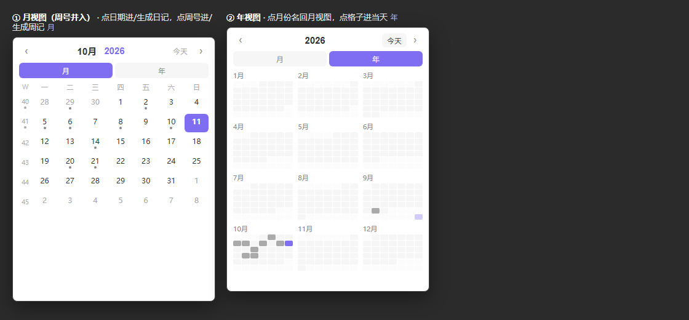

# Simple Calendar

[English](#english) · [简体中文](#简体中文)

---

## English

A lightweight calendar for Obsidian: **month / week / year views, one click to create or open a daily or weekly note.**



### Why

The community [Calendar](https://github.com/liamcain/obsidian-calendar-plugin) plugin has not been maintained for years (its newest release is `2.0.0-beta.2`; hundreds of issues are open), it has **no Templater integration** — it only substitutes the core Daily Notes `{{date}}`-style placeholders — and its weekly-note feature was deprecated and moved into Periodic Notes. So if your daily/weekly templates use Templater syntax (`<% tp.file.title %>`), clicking a date creates a note whose template is **not executed**.

This plugin does the same job with that gap closed, and adds year view.

### Features

| Feature | Detail |
|---|---|
| **Month view + week numbers** | 6×7 grid (always 42 cells, so the height never jumps) with an **ISO week-number column** on the left — the same shape as the original Calendar. Click a day to open or create its daily note; **click a week number to open or create that week's note**. Days that have a note get a dot; today is highlighted. |
| **Year view** | Twelve mini-months. Click a month name to jump into month view; click a cell to open that day. |
| **Navigation** | `‹` `›` step by month (by year in year view) · click the **month name** to return to month view · click the **year number** to jump to year view · a **今天** button returns to today · Ctrl/Cmd+click opens in a new tab. |
| **Open or create** | Click any day: opens the note if it exists, otherwise creates it from your template. Ctrl/Cmd+click opens in a new tab. |
| **Templater first** | Creation goes through Templater, so `<% %>` in your template is really executed. Falls back to core `{{date}}`/`{{title}}` substitution, then to an empty file. |
| **Follows your settings** | Reads the core Daily Notes plugin for folder / format / template. Weekly notes have their own format, folder and template (default folder = the daily folder). |
| **Sidebar** | A normal Obsidian view: it opens in the right sidebar and can be dragged anywhere or pinned. |
| **No dependencies** | No Periodic Notes, no Svelte, no build step. `main.js` is the source. |

### How the integration works

1. **Daily settings** are read from the core *Daily notes* plugin at runtime — folder, filename format and template. Change them in Obsidian and this calendar follows; no duplicated configuration.
2. **Templater** is called through its own API: `app.plugins.plugins['templater-obsidian'].templater.create_new_note_from_template(template, folder, filename, open)`. The filename is passed without `.md`; Templater resolves the final path with `getAvailablePath`, so an existing note is never overwritten.
3. If Templater is disabled or the template is missing, the plugin falls back to core placeholder substitution, then to creating an empty file — and tells you which path it took.

### Install (manual)

1. Copy `main.js`, `manifest.json`, `styles.css` and `versions.json` into `<your vault>/.obsidian/plugins/simple-calendar/`.
2. Reload Obsidian (`Ctrl+P` → *Reload app without saving*).
3. Enable **Simple Calendar** in *Settings → Community plugins*.

Or use the bundled script:

```powershell
powershell -NoProfile -ExecutionPolicy Bypass -File tools\deploy.ps1 -Vault "E:\Dnotes" -Enable
```

### Settings

| Section | Items |
|---|---|
| View | Default view (month / year) · week starts on (locale / Monday / Sunday) · show the ISO week-number column · mark days that have a note · open the calendar on startup |
| Daily | Follow the core Daily notes settings, or set format / folder / template yourself |
| Weekly | Format (default `gggg-[第]WW[周【周记】]`) · folder (empty = same as daily) · template |
| Create | Confirm before creating |
| About | Why it is fast |

### Why it is fast

- **It never reads note contents.** "Does this day have a note?" is answered from the vault's path index only. Reading files to compute word counts is what makes other calendars slow.
- **One render per interaction.** The whole grid is built in a `DocumentFragment` and swapped in once, with a single delegated click listener — no per-cell handlers, no framework.
- **Only two triggers redraw it:** vault create/delete/rename (debounced 250 ms) and the day rolling over (a once-per-minute string comparison).
- Date maths uses `moment`, which Obsidian already ships.

### Compatibility

- Desktop and mobile (`isDesktopOnly: false`); minimum Obsidian 1.5.0.
- Works with or without the core Daily notes plugin, with or without Templater (see the fallback chain above).
- Independent of Periodic Notes — weekly notes are built in.

### Development

`main.js` is the source and the artifact. Its header documents the five design rules.

```
simple-calendar/
├── main.js              §1 constants · §2 pure functions · §3 plugin · §4 view · §5 settings
├── manifest.json  styles.css  versions.json
├── README.md  LICENSE  .gitignore
├── assets/preview.png
└── tools/
    ├── test.mjs         node tools/test.mjs  — unit tests for §2 (no Obsidian needed)
    ├── preview.html     renders the three views at sidebar width
    ├── shot-preview.ps1 headless-Edge screenshot of preview.html
    └── deploy.ps1 / deploy.bat
```

```bash
node tools/test.mjs
```

### License

MIT — see [LICENSE](LICENSE).

---

## 简体中文

给 Obsidian 用的轻量日历：**月 / 周 / 年三种视图，点一下就能生成或进入日记、周记。**


### 为什么做

社区的 [Calendar](https://github.com/liamcain/obsidian-calendar-plugin) 已经多年没维护（最新版还是 `2.0.0-beta.2`，几百个 issue 挂着），而且它**没有 Templater 联动** —— 只会替换核心日记的 `{{date}}` 这类占位符；周记功能也已被弃用、拆去 Periodic Notes。所以如果你的日记 / 周记模板是 Templater 语法（`<% tp.file.title %>`），点日期生成出来的笔记里，模板**根本没被执行**。

本插件把这件事重做了一遍，补上这个缺口，并加了年视图。

### 功能

| 功能 | 说明 |
|---|---|
| **月视图 + 周号列** | 6×7 固定 42 格（翻月不会跳高度），左侧多一列 **ISO 周号** —— 与原插件同一种形态。点日期 = 进入或生成日记；**点周号 = 进入或生成那一周的周记**。有笔记的日子带小点，今天高亮。 |
| **年视图** | 十二个迷你月。点月份名切到月视图，点格子进对应那天。 |
| **导航** | `‹` `›` 按月翻（年视图里按年翻）· 点**月份名**回月视图 · 点**年份数字**跳年视图 · **今天**按钮回到当天 · Ctrl/Cmd + 点击在新标签页打开。 |
| **进入或生成** | 点任意一天：有笔记就打开，没有就用你的模板生成。Ctrl/Cmd + 点击在新标签页打开。 |
| **Templater 优先** | 生成走 Templater，模板里的 `<% %>` 会被真正执行；不可用时退回核心 `{{date}}`/`{{title}}` 替换，最后才建空文件。 |
| **跟随你的设置** | 文件夹 / 格式 / 模板从核心「日记」插件读取；周记有自己的格式、目录、模板（目录留空 = 与日记同目录）。 |
| **侧边栏** | 就是普通的 Obsidian 视图：默认开在右侧栏，可拖到任意位置或固定。 |
| **零依赖** | 不需要 Periodic Notes，不用 Svelte，没有构建步骤 —— `main.js` 本身就是源码。 |

### 联动是怎么做的

1. **日记设置**在运行时从核心「日记」插件读取（文件夹、命名格式、模板）—— 你在 Obsidian 里改，日历跟着变，不需要两处配置。
2. **Templater** 走它自己的 API：`app.plugins.plugins['templater-obsidian'].templater.create_new_note_from_template(template, folder, filename, open)`。文件名不带 `.md`；Templater 内部用 `getAvailablePath` 落盘，**不会覆盖**已有笔记。
3. Templater 被禁用或模板找不到时，退回核心占位符替换，再退回建空文件 —— 并且会提示走了哪条路。

### 安装（手动）

1. 把 `main.js`、`manifest.json`、`styles.css`、`versions.json` 放到 `<你的库>/.obsidian/plugins/simple-calendar/`；
2. `Ctrl+P` →「重新加载应用而不保存」；
3. 设置 → 第三方插件 → 启用 **Simple Calendar**。

也可以用仓库里的脚本：

```powershell
powershell -NoProfile -ExecutionPolicy Bypass -File tools\deploy.ps1 -Vault "E:\Dnotes" -Enable
```

### 设置项

| 分组 | 项目 |
|---|---|
| 视图 | 默认视图（月 / 年）· 每周起始（跟随系统 / 周一 / 周日）· 显示 ISO 周号列 · 标记有笔记的日子 · 启动时打开日历 |
| 日记 | 跟随核心「日记」设置，或自己指定格式 / 文件夹 / 模板 |
| 周记 | 格式（默认 `gggg-[第]WW[周【周记】]`）· 文件夹（留空 = 与日记同目录）· 模板 |
| 创建 | 新建前确认 |
| 关于 | 为什么快 |

### 为什么快

- **从不读取笔记正文**：判断"这天有没有笔记"只查库的路径索引。为了算字数去读每个文件，正是别的日历变慢的原因。
- **一次交互一次渲染**：整块网格在 `DocumentFragment` 里建好一次替换，全程只有一个事件委托监听器 —— 没有逐格监听、没有框架。
- **只有两件事会触发重绘**：库内增删改名（防抖 250ms）与跨天（每分钟一次字符串比较）。
- 日期运算用 Obsidian 自带的 `moment`，不额外打包。

### 兼容性

- 桌面端与移动端都可（`isDesktopOnly: false`），最低 Obsidian 1.5.0；
- 有没有核心「日记」插件都能用，有没有 Templater 也都能用（见上面的降级链）；
- 不依赖 Periodic Notes —— 周记是自带的。

### 开发

`main.js` 既是源码也是产物，文件头写明五条设计红线。

```bash
node tools/test.mjs
```

### 许可证

MIT，见 [LICENSE](LICENSE)。
